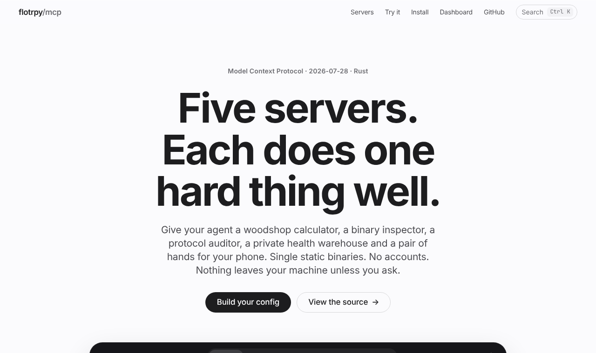

# Five MCP servers in Rust

**Five servers. Each does one hard thing well.** Five open-source [Model Context Protocol](https://modelcontextprotocol.io) servers that give your agent a woodshop calculator, a binary inspector, a protocol auditor, a private health warehouse and a pair of hands for your phone. Each is a single static binary with no accounts or daemons, speaks both protocol generations, and is graded A by its own auditor on every push.

<p>
  <a href="https://github.com/Flotrpy/mcp/actions/workflows/ci.yml"></a>
  
  
  
  <a href="LICENSE"></a>
</p>

<p>
  
  
  
  
  
</p>

<p>
  
  
  <a href="https://flotrpy.github.io/mcp/dashboard.html"></a>
  <a href="https://flotrpy.github.io/mcp/"></a>
  
</p>

<a href="https://flotrpy.github.io/mcp/">
  <picture>
    <source media="(prefers-color-scheme: dark)" srcset="docs/images/site-dark.png">
    
  </picture>
</a>

| Server | What it does | Tools |
|---|---|---|
| [**joinery**](crates/joinery) | Woodworking: parametric furniture, cut lists, kerf- and grain-aware sheet nesting, shelf-sag physics | 4 |
| [**binscope**](crates/binscope) | Read-only inspection of ELF/PE/Mach-O files: sections, entropy, imports, ranked strings, a diff of two builds | 4 |
| [**lighthouse**](crates/lighthouse) | Audits any MCP server: both protocols, tool lint, token cost, an A–F grade, `mcp.lock` drift pinning | 4 |
| [**vitals**](crates/vitals) | A local health warehouse: Apple Health and CSV import, phone/watch de-duplication, explainable readiness | 5 |
| [**handset**](crates/handset) | Drives Android and the iOS Simulator with compact ref-tagged screens and change-only replies | 4 |

## Install

```sh
cargo install --git https://github.com/Flotrpy/mcp joinery binscope lighthouse vitals handset
```

Prebuilt binaries for Linux, macOS and Windows are attached to each [release](https://github.com/Flotrpy/mcp/releases). Then add the servers you want to your client:

```json
{
  "mcpServers": {
    "joinery": { "command": "joinery-mcp" },
    "lighthouse": { "command": "lighthouse-mcp" }
  }
}
```

The [website](site/) has a config builder for Claude Code, Claude Desktop, Cursor and Codex.

## Quality gates
- **Tests:** `cargo test --workspace` runs 130 unit and end-to-end tests. The end-to-end tests drive each compiled binary over stdio, on both protocol generations.
- **CI** runs fmt, `clippy -D warnings`, the tests, and the site's JS tests. It then has **lighthouse audit every server** and fails below an A, and **verify each against its committed `locks/*.lock`**, which fails on any silent change to a tool's description or schema.
- **Dashboard:** `site/dashboard.html` shows the latest audit, with grades, token cost per tool and lockfile status.

## Layout

```text
crates/
  mcp-kit/      shared bootstrap, token budgets, result helpers, CLI, test harness
  joinery/  binscope/  lighthouse/  vitals/  handset/
locks/          mcp.lock for each server (checked in CI)
site/           static website and dashboard (no build step)
docs/           design decisions and UI research
research/       the ideas research, its data and the scripts that collected it
examples/       a 35-day multi-device vitals dataset
```

## Docs
- [Design decisions](docs/DESIGN.md): protocol layer, transport, stack, and what makes each server different.
- [UI research](docs/UI-RESEARCH.md): what the Apple HIG, Apple's kits, Emil Kowalski and Dribbble each recommend, and which won.
- [Research](research/mcp-ideas-master.md): the 34 ideas these were chosen from, with the Hacker News and web sweeps behind them.

## License

MIT
